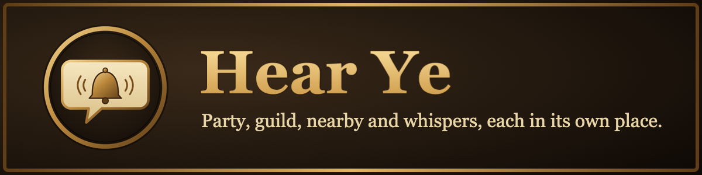

# CurseForge listing

Everything the project form asks for. Paste the description in Markdown mode, and use [art/logo.png](../art/logo.png) as the logo.

Before 1.0, drop the early-testing line. The five screenshots in [docs/screenshots/curseforge](screenshots/curseforge) go in the gallery only, not the description. Retake them when the window's look changes, with only your own characters' messages in them.

| Field | Value |
| --- | --- |
| Game | World of Warcraft |
| Class | Addons |
| Name | Hear Ye |
| Summary | A compact chat window that keeps party, guild, nearby and whispers in their own rows, so you stop missing messages. |
| Main category | Chat & Communication |
| Additional categories | Guild, if it's offered |
| Allow comments | On |
| Experimental | Off |
| Game version | 1.60.1 (WoW Forever) |
| License | MIT |

## Description

**Hear ye, hear ye!**

Did someone just whisper you? Did your party ask you something three trade spam lines ago? Hear Ye keeps each conversation in its own row, with an unread count, in one small window that looks like part of the game.

**Hear Ye is in early testing.** Raid chat and combat have had the least testing so far.

## Every conversation in its own row

Say, Party, Raid, Guild, each channel you've joined and each person who whispers you get a row, with a red pill for what you haven't read. Shrink the list to short names when you want more room to read.

## The chat you already know

Press Enter and type as usual. Slash commands, /r, Tab, history and Shift-clicking links all work the way they always have. Click a row to read it, then press Enter to talk there. Clicking never stops you walking, and typing /p or /w Name moves the window to that row too. Switch rows mid-sentence and your text waits in the row you left.

## Stays out of the way

Hear Ye sizes itself and sits just above your action bars, beside your character, at any resolution. The background fades when the mouse is away. After 10 quiet seconds the open conversation fades too, while the list stays, and it comes back when someone talks there or you hover or type.

## Keeps what matters

Whispers, party, raid and guild keep their last 50 lines for a day, so a reload or quick relog doesn't wipe them. Public channels start fresh, like the default chat. Battle.net friends show by the character they're playing, or their BattleTag, never their real name.

## Replacing the default chat

The first time you log in, a short setup asks whether Hear Ye should replace the default chat window. You can switch back at any time with `/hearye chat`, and Edit Mode always brings the default chat back while it's open. Hear Ye never filters or changes the default chat, so turning it off leaves everything as it was.

## Good to know

During boss encounters and some combat, the game hides chat details from addons. Hear Ye then shows the game's own line for the message, in its row when it can tell which one, or in the Game row. Hear Ye is free and isn't affiliated with Blizzard. Bugs or ideas: leave a comment, or open an issue on [GitHub](https://github.com/alexinslc/hear-ye).

## Commands

| Command | What it does |
| --- | --- |
| `/hearye` | Show or hide the window |
| `/hearye setup` | The quick setup, also on the gear in the title bar |
| `/hearye chat` | Switch between Hear Ye and the default chat window |
| `/hearye clear` | Clear saved messages for this character (asks first) |
| `/hearye lock` or `/hearye unlock` | Lock the window in place |
| `/hearye reset` | Put the window back over the chat area |
| `/hearye status` | Print what Hear Ye can read, for bug reports |
