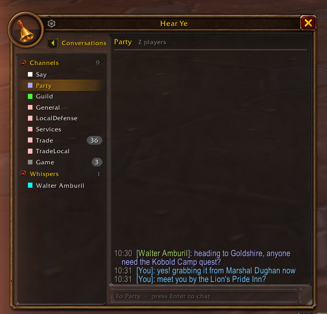
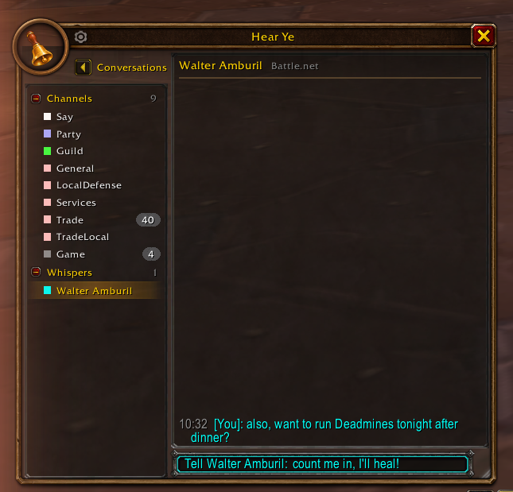
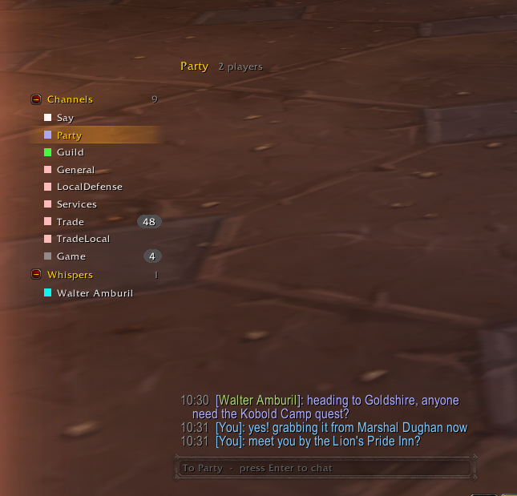
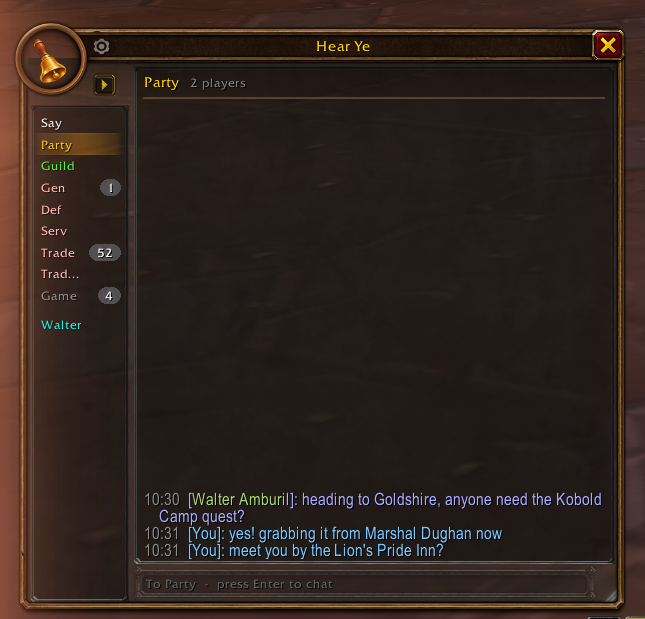
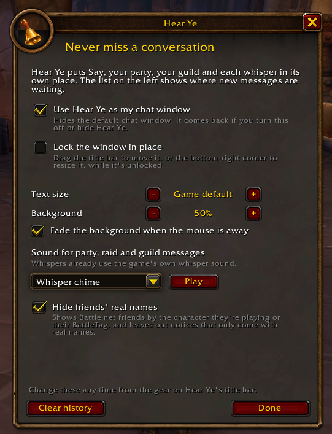

# CurseForge listing

Everything the project form asks for. Paste the description in Markdown mode, and use [art/logo.png](../art/logo.png) as the logo.

Before 1.0, drop the early-testing line. The gallery has the five images in [docs/screenshots/curseforge](screenshots/curseforge), titled as in the description. Retake them when the window's look changes, with only your own characters' messages in them.

| Field | Value |
| --- | --- |
| Game | World of Warcraft |
| Class | Addons |
| Name | Hear Ye |
| Summary | A compact chat window that keeps party, guild, nearby and whispers in their own rows, so you stop missing messages. |
| Main category | Chat & Communication |
| Additional categories | Guild, if it's offered |
| Allow comments | On |
| Experimental | Off |
| Game version | 1.60.1 (WoW Forever) |
| License | MIT |

## Description

**Did someone just whisper you? Did your party ask you something three trade spam lines ago?** Hear Ye keeps each conversation in its own row, with an unread count, in one small window that looks like part of the game.

**Hear Ye is in early testing.** Raid chat and combat have had the least testing so far.

### What it does

- **One row per conversation:** Say, Party, Raid, Guild, each channel you've joined, and each person who whispers you. A red pill shows what you haven't read.
- **The game's own chat box:** press Enter and type as usual. Slash commands, /r, Tab, history and Shift-clicking links all work the way they always have.
- **Click a row to read it,** then press Enter to talk there. Clicking never stops you walking. Typing /p or /w Name moves the window to that row too.
- **Unsent text stays put:** switch rows mid-sentence and your text waits in the row you left.
- **Survives a reload:** whispers, party, raid and guild keep their last 50 lines for a day, so a reload or quick relog doesn't wipe them. Public channels start fresh, like the default chat.
- **See-through:** set how solid the background is, and let it fade when the mouse is away, like the default chat.
- **Battle.net friends by character or BattleTag:** friends show by the character they're playing, or their BattleTag, never their real name. You can turn this off in the settings.
- **Compact list:** shrink the conversation list to short names and unread counts for more room to read.
- **Fits your screen:** it sizes itself and sits just above your action bars, beside your character, at any resolution.

 

### Replacing the default chat

The first time you log in, a short setup asks whether Hear Ye should replace the default chat window. You can switch back at any time with `/hearye chat`, and Edit Mode always brings the default chat back while it's open. Hear Ye never filters or changes the default chat, so turning it off leaves everything as it was.

### Commands

| Command | What it does |
| --- | --- |
| `/hearye` | Show or hide the window |
| `/hearye setup` | The quick setup, also on the gear in the title bar |
| `/hearye chat` | Switch between Hear Ye and the default chat window |
| `/hearye clear` | Clear saved messages for this character (asks first) |
| `/hearye lock` or `/hearye unlock` | Lock the window in place |
| `/hearye reset` | Put the window back over the chat area |
| `/hearye status` | Print what Hear Ye can read, for bug reports |

### Good to know

During boss encounters and some combat, the game hides chat details from addons. Hear Ye then shows the game's own line for the message, in its row when it can tell which one, or in the Game row. This addon is free, and it isn't affiliated with or endorsed by Blizzard Entertainment.

Found a bug or have an idea? Leave a comment, or open an issue on [GitHub](https://github.com/alexinslc/hear-ye).
